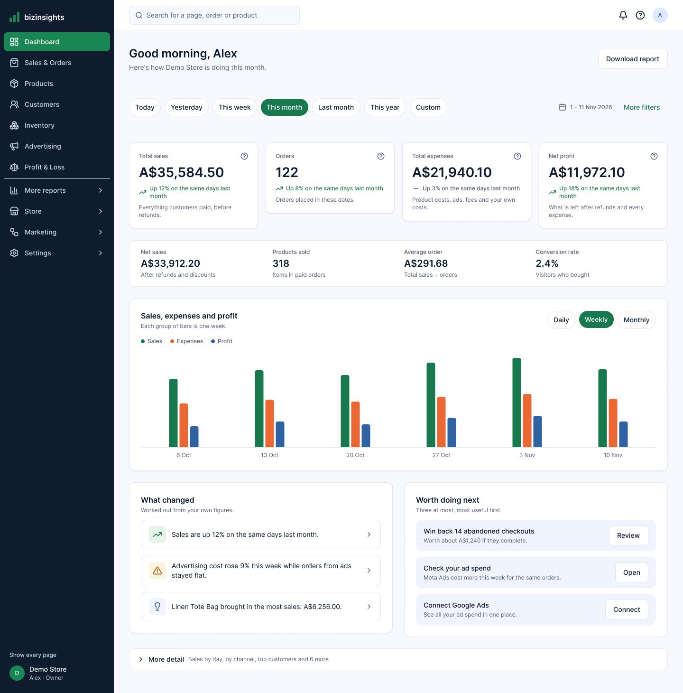
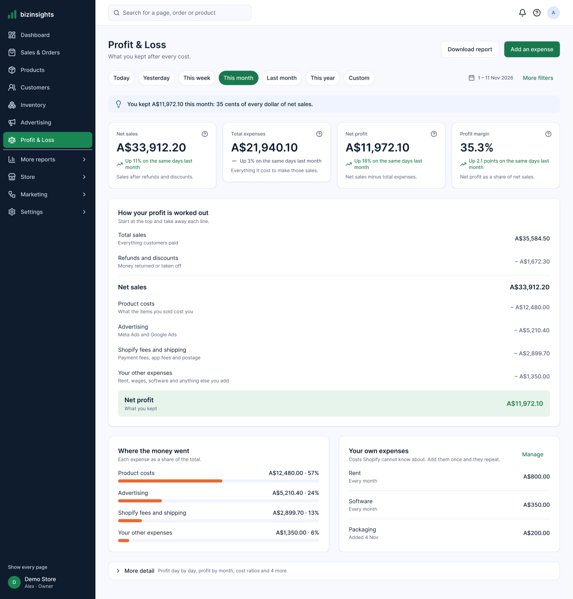
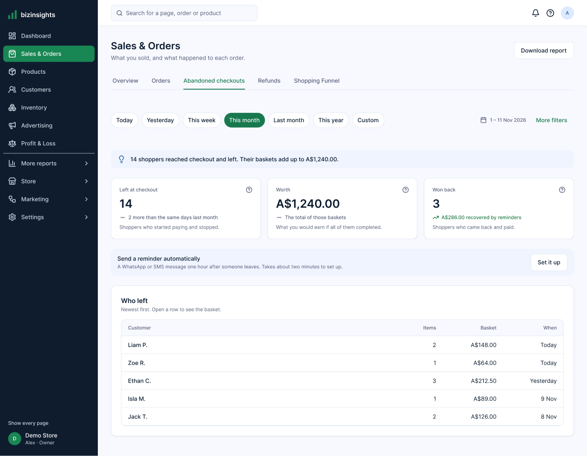
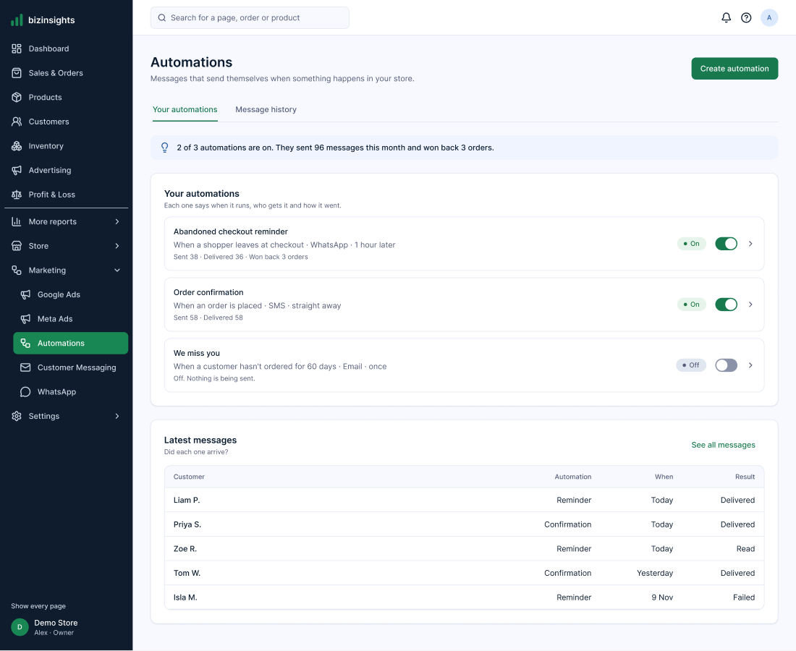
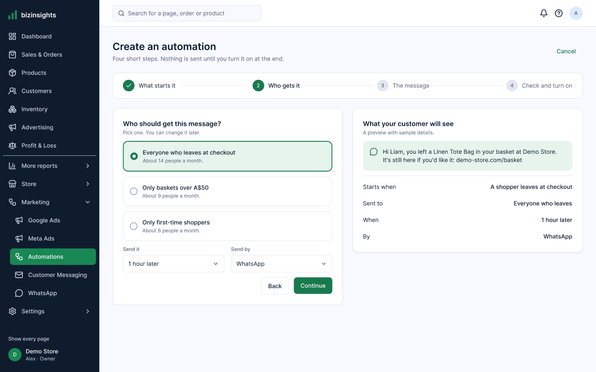
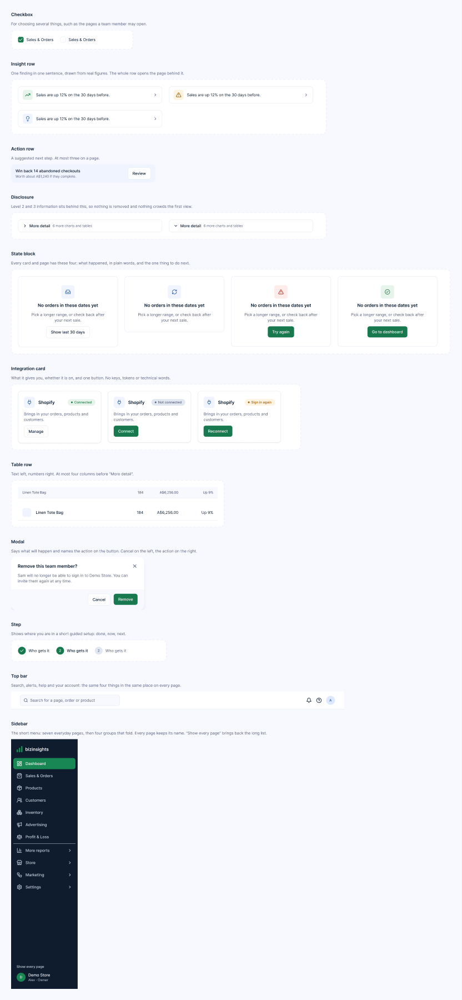

# A simpler bizinsights: audit, navigation, design and build plan

Written 2026-11-11 against the owner's brief "Complete SaaS dashboard UX/UI redesign" (ten phases: audit,
research, navigation, design strategy, Stitch screens, Figma prototype, development plan, implementation,
QA, deployment). The brief's rule is **keep every feature, cut what a beginner has to face**, and nothing
is to be built before the design is approved. Nothing in the app was changed for this document.

## Where each phase stands

| Phase | State |
|---|---|
| 1 Audit | Below. Read from the code of every signed-in page on `main`, not from screenshots (see the note under the table). |
| 2 Research | Below: what makes the app hard, with the evidence. |
| 3 Navigation | Below. The folded menu is already built: [pull request 361](https://github.com/html-proof/pixmagic-projects/pull/361), not merged. |
| 4 Design strategy | Below. |
| 5 Stitch screens | Done earlier today by another session: 24 screens, one per live page, in [Stitch project 4547206425003652042](https://stitch.google.com/projects/4547206425003652042). |
| 6 Figma | Partly done: tokens, 20 components, 14 desktop screens. No click-through, no phone screens. Figma's free plan stopped the build. See [figma/README.md](figma/README.md). |
| 7 Development plan | Below. |
| 8 to 10 Build, QA, deploy | Not started. They wait for the owner's approval of the design. |

**About the audit's source.** The brief asks for an audit of screenshots. Another session captured all 25
live pages this morning and sent them to Stitch; those files could not be found on disk from this session,
so this audit is taken from the pages' code: every heading, control and label as written. Counts such as
"13 tiles" are counts of what the code draws for an owner with everything connected. An older map with 135
screenshots is in [docs/design-architecture](../design-architecture/README.md) (30 October, before the
current look).

## The design in pictures

Captured from the Figma file. Sample figures for "Demo Store".

| | |
|---|---|
|  Home (the date row has since been tightened) |  Profit & Loss |
|  Sales & Orders, Abandoned checkouts tab |  Automations |
|  Create an automation, step 2 |  Some of the components |

## 1. Audit, page by page

"Hard for a beginner" lists only what the code shows. "Keep" is everything the page does today; nothing
below is removed, it is folded.

| Page | What it is for | Hard for a beginner | Proposed first view | Folded under "More detail" |
|---|---|---|---|---|
| **Home** (simple) | How the store is doing | 8 sections; one date chip that opens a list of 15+ ranges; no profit chart | Greeting, 7 date chips, 4 big numbers, 4 small ones, one chart (sales, expenses, profit), 3 findings, 3 next steps | The full dashboard's 7 cards, "More insights you can unlock", "About this data" |
| **Full dashboard** | Everything at once | 4 tiles, then about 12 cards and 2 pickers; "YTD", "return on ad spend" | Stays as it is, reached from Home's "More detail" | — |
| **Sales & Orders** | What sold | 4 tiles, 7 cards, then a "More detail" heading that is **not folded** with 6 more blocks; "Gross sales", "Net sales", "Gross profit" side by side; 8 tabs across the top | "In short" line, 4 numbers, one chart, latest orders. Tabs: Overview, Orders, Abandoned checkouts, Refunds, Shopping Funnel | Sales by channel, where buyers came from, busiest times, discount codes, the Shopify check, the before/after table, returns |
| **Products** | What sells | "Top 100 products" as the first table; stock lives in a different area | 3 numbers (sold, best seller, running low), best sellers with pictures | All products, collections, never sold, returns |
| **Customers** | Who buys | "Monthly cohorts", "Repeat purchase rate" | New against returning, 4 numbers, customers to follow up | Cohorts, repeat customers |
| **Orders, Shipping, Sales channels, Discounts** | Order handling | Four menu entries for what an owner thinks of as "orders" | Tabs of Sales & Orders (Orders, Refunds) | Shipping, channels, discount codes |
| **Inventory** (8 pages) | Stock | A second left menu of 8; up to 16 tiles; "Committed", "Incoming", "Sell-through", "Turnover", "Variants" | One tab row; 4 numbers (in stock, running low, sold out, value); "Stock that needs attention" | The other 12 tiles, movements, reports, settings |
| **Advertising** (8 pages) | Ad spend and return | A second left menu of 8; "ROAS", "MER", "CTR", "CPC", "CPM", "Attributed revenue"; 10 cards on the overview | 4 numbers led by "Ad spend" and "Back for every A$1 (ROAS)", one card per platform, campaigns table. Tabs: Overview, Meta Ads, Google Ads, Campaigns | Funnel, audience, Shopify attribution, profitability, AdSense, reports |
| **Profit & Loss** | What was kept | About 13 tiles including "MER", "Sitewide ROAS", "VCR", "FCR"; 3 buttons and 4 controls in the header | 4 numbers, then the sum written out line by line from total sales down to net profit, where the money went, your own expenses | The statement, ratios, expense search, recurring payments, categories |
| **Profit sheet** | Profit day by day | About 25 rows: "Operating profit", "Allocated fixed costs", "Below operating" | Stays, as "More detail" of Profit & Loss and in More reports | — |
| **Shopping Funnel** | Where shoppers drop out | 12 sections; abandoned checkouts are the 11th; "pixel", "sessions", "drop-off" | Journey chart, 4 numbers, "Where you lose customers" | Product-level funnel, trends, formulas |
| **Automations** (4 pages) | Messages that send themselves | Three separate builders: the hub (4 steps, SMS and email), WhatsApp (5 steps), SMS's own; "event API key"; "Accepted by the provider isn't the same as delivered" | List of automations, each saying when it runs, who gets it and how it went, with an on/off switch; latest messages with one result word | Audit log, provider reports, test mode |
| **Customer Messaging** (5 + 8 pages) | SMS | "Sender ID", "DLT Principal Entity ID", "Suppression list", "SMS segments" | A tab of Automations: Send a message | Sender, permissions, costs, templates, segments, delivery analytics |
| **WhatsApp** (8 tabs) | WhatsApp messages | "Cloud API", "Access token", "Phone number ID" on a merchant screen | Setup as 3 plain steps; its automations listed with the others | Templates, campaigns, technical settings |
| **Integrations** | Connections | About 20 different status phrases ("Authorization required", "Verification pending", "Sync failed"…) | One card each: what it gives, one of 4 statuses (Connected, Not connected, Connecting, Needs attention), one button | Zapier, AdSense, event history |
| **Team & Access** | Who can see what | 5 summary tiles; 6 roles; permissions in 11 areas with tags; 4 filters | People table and one "Invite someone" button. The invitation: email, what they can do, 7 page ticks | The 11 permission areas, access end date, history, filters |
| **Settings** (12 pages) | Account and business | Account, security, costs, privacy, audit log and connections in one list | Three groups: You (profile, security, notifications), Business (workspace, costs, team), Advanced (privacy requests, audit log) | — |
| **Staff** (11 pages), **My work** | Rosters and pay | A third left menu of 11 | Unchanged in this round: an optional module, off for App Store installs | — |
| **Reports / exports** | Getting figures out | "Download", "Export CSV", "Download CSV", "Download by day", "Print", "Print or save as PDF" in different places per page; Advertising has its own Reports page | One "Download report" button, top right on every page, opening one dialog: which report, dates, PDF or spreadsheet | — |

Duplicates found: sales totals on Home, Business Overview and Sales; "Orders at a glance" on the dashboard
and under Orders; ad figures on the dashboard, Advertising and Profit & Loss; automations builders (three);
message history (hub, SMS, WhatsApp); integrations status (Integrations, Settings › Shopify, Settings ›
Advertising, each module's own setup).

## 2. What makes it hard

| Principle | What the app does today | What the design does |
|---|---|---|
| Hick's law (choices slow people down) | 22 menu rows for an owner; 7 areas with their own second menu (8, 8, 4, 13, 8, 11, 12 items); a date list of 15+ ranges | 7 everyday rows and 4 folded groups; second menus become one tab row; 7 date chips, the rest behind "More filters" |
| Cognitive load | Up to 16 tiles on a page; three names for sales on one page; about 20 integration statuses | At most 4 big numbers per page; one "In short" sentence; 4 status words |
| Fitts's law | Export, print and add buttons move from page to page | The page's one main action is always top right; buttons 40 px tall, 44 px on phones |
| Progressive disclosure | Sales's "More detail" is a heading, not a fold; "What these numbers mean" is always open | One "More detail" row per page that says what is inside it and remembers being opened |
| Recognition over recall | ROAS, MER, VCR, FCR, AOV, CTR, CPC, SKU, cohorts, pixel, sessions | Plain name first, the trade name after it once: "Back for every A$1 (ROAS)". Ratios move under "More detail" |
| Decision anxiety | A page opens on figures with no sentence saying what they mean | Every page answers four things in order: title (where am I), purpose line (what is this), "In short" (what does it say), one main button (what next). Connect dialogs say what will happen and what will never happen |

No dark patterns: no countdowns, no pre-ticked upsells, no extra confirmation on harmless actions; a
confirmation only where something is removed or sent to customers.

## 3. Navigation

The brief proposes ten top-level items "as a starting structure". The app already has a built answer in
pull request 361 (flag `SIMPLE_MENU`): seven everyday pages listed, the rest in four groups that fold, every
page keeping today's name and address, and "Show every page" to bring the long list back. The Figma screens
use that menu. It covers the brief's ten like this:

| The brief's item | In the folded menu | Pages inside |
|---|---|---|
| Home | Dashboard | Home; full dashboard under "More detail" |
| Sales | Sales & Orders | Overview, Orders, Abandoned checkouts, Refunds, Shopping Funnel (tabs) |
| Products | Products, Inventory | Best sellers, all products, collections; stock |
| Customers | Customers | Overview, new against returning, follow-ups |
| Marketing | Advertising | Overview, Meta Ads, Google Ads, Campaigns (tabs) |
| Expenses & Profit | Profit & Loss | The sum, expenses; Profit sheet under More reports |
| Reports | More reports (group) + "Download report" on every page | Business Overview, Profit sheet, Discounts, Shopping Funnel |
| Automations | Marketing (group) | Automations, Customer Messaging, WhatsApp |
| Integrations | Settings (group) | Integrations |
| Settings | Settings (group) | Team & Access, Business Settings |
| — | Store (group) | Orders, Shipping, Sales channels, Staff |

Differences from the brief, on purpose:

- **Names are today's** ("Advertising", not "Marketing"; "Profit & Loss", not "Expenses & Profit"). The
  six-area menu with new names was built on 30 October and reverted at the owner's request the next day, so
  renaming waits for an explicit yes.
- **Integrations and Automations are one click deeper** than in the brief (inside a group). Home links
  straight to both when something needs doing.

New in this design, beyond pull request 361: Abandoned checkouts and Refunds as tabs of Sales & Orders, and
second left menus drawn as one tab row.

## 4. Design strategy

**Three levels on every page.** Level 1, always showing: title, purpose line, "In short", up to 4 numbers,
one chart or one table. Level 2, one click: "More detail", holding every other card the page has today.
Level 3, inside "More detail" or under Settings: single permissions, ratios, technical setup, histories.

**Design system** (as built in Figma, from the app's own values so nothing has to be re-themed):

| | |
|---|---|
| Colour | Background `#f8f9ff`, cards white, text `#0b1c30`, secondary text `#565d79`, lines `#e1e7f0`, action green `#18794e`, menu navy `#0f1c2e`. Meaning only: green good, amber `#a15c07` attention, red `#b42318` failed, blue `#2f62a3` information, each with a soft tint and always with a word |
| Type | Inter. Page title 24/32 semibold, section title 16/24 semibold, big figure 28/36, small figure 20/28, body 14/20, label 12/16 medium, caption 12/16 |
| Spacing | 4, 8, 12, 16, 20, 24, 32, 40, 48. Page padding 32, between cards 24, inside cards 24 |
| Shape | Cards 12 px corners with a hairline and the faintest shadow; buttons and fields 8 px; pills round |
| Charts | Bars only on first views; three series colours (sales green, expenses orange, profit blue); the legend in words |

Two places where the design does not follow the brief, both the owner's call:

1. **Primary colour.** The brief says "professional blue". The product's brand and logo are green, so the
   design keeps green for actions and uses blue for information. One variable (`color/accent`) changes it.
2. **Home shows 4 big numbers and 4 small ones**, not 8 equal cards: total sales, orders, total expenses and
   net profit large; net sales, products sold, average order and conversion rate in one quieter row.

**Screens.** Desktop at 1440 px is designed. Tablet and phone are specified here and not yet drawn: under
1024 px the menu becomes a drawer behind a menu button; numbers go two across on tablet and one across on
phone; date chips scroll sideways; tables keep the first and last column and move the rest into the row's
detail; the page's main button sits full width at the foot of the screen on phones.

**States.** Every card and page has four: empty (says why and offers one thing to do), loading (grey bars
in the shape of what is coming), error ("We couldn't load this. Your data is safe."), success. They exist
as one component in Figma.

## 5. The ten journeys

Counted from Home after signing in. "Today" is read from the code of the short menu (pull request 361);
it was not clicked through on the live site for this document.

| # | The client wants to… | Today | In the design | What trips people today |
|---|---|---|---|---|
| 1 | Sign in for the first time | Home with figures still importing and a "Needs you" list | Home with a 3-step list (Shopify done, connect ads, invite team) and "Getting your figures" in words | No sign of what to do first |
| 2 | See today's sales | 2 clicks: open the date chip, pick Today | 1 click: the Today chip is showing | The range is hidden in a list of 15+ |
| 3 | Find the best seller | 1 click (Products) | 0: Home says it in a sentence; 1 click for the list | "Top 100 products" before the answer |
| 4 | Understand profit | 1 click, then 13 tiles | 0 for the figure; 1 click for the sum written out | MER, VCR, FCR; "Left over" on Home against "Profit or loss" on the page |
| 5 | Check ad spend | 1 click, then ROAS and MER tiles | 1 click; "Ad spend" is the first number | The trade terms come first |
| 6 | Find abandoned checkouts | 2 clicks (More reports, Shopping Funnel), then scroll to the 11th section | 1 click from Home's "Worth doing next", or 2 by the menu and tab | Filed under "funnel" |
| 7 | Connect an integration | 3 clicks to the provider | The same 3, or 2 from Home, with a dialog first saying what will and won't happen | About 20 status phrases |
| 8 | Set up a WhatsApp automation | 4 clicks to the builder, then 5 steps, in a builder separate from SMS and email | 3 clicks, then 4 steps, WhatsApp as one of three ways to send | Three builders; "Cloud API", "Access token" |
| 9 | Download a report | A different button on each page; CSV only, PDF by printing | 2 clicks and Download, the same place on every page | Six different labels |
| 10 | Invite someone with limits | 4 clicks, then 6 roles and 11 permission areas | The same 4 clicks, then a role and 7 ticks | Too many decisions before Send |

Security and accuracy are untouched: the same permissions are sent, the page ticks are a simpler face on
them, and the full list stays one click away.

## 6. Development plan

Rules: the backend and every calculation stay as they are; no route changes, so the route access matrix is
unchanged; each step ships behind its own flag in `apps/web/src/lib/features.ts`, by pull request to `main`,
and is live only after its Deploy run succeeds. Existing pieces to reuse: `PageKit` (`Card`, `InShortLine`,
`FigureTile`, `PageTabs`), `AppUi` (`PageHeader`, `Dialog`, `ConfirmDialog`, `Skeleton`), `EmptyState`,
`LoadError`.

| Step | What changes | Size | Depends on |
|---|---|---|---|
| A | Merge the short menu, the look-around and the figure notes (pull request 361: its last CI run died when the PC runner dropped offline, not on a test) | Built | A CI re-run |
| B | `MoreDetail` in PageKit: one fold per page that names what is inside and is remembered per device. Apply to Sales, Products, Customers, Funnel | Small | — |
| C | Home: 7 date chips; the small-numbers row; the sales, expenses and profit chart; "Worth doing next" capped at 3 | Medium | — |
| D | Second left menus become a tab row (`SectionLayout` to `PageTabs`, with an overflow past 6): Inventory, Advertising, Automations, Messaging, WhatsApp, Settings | Medium | — |
| E | Abandoned checkouts and Refunds as tabs of Sales & Orders (both sets of figures already exist, on the Funnel and Orders pages) | Small | D |
| F | Profit & Loss: 4 numbers and the written-out sum first; the other tiles and ratios under More detail | Small | B |
| G | Plain names: one wording file for figures ("Back for every $1 (ROAS)", "Average order"), and Integrations' statuses reduced to 4 | Small | — |
| H | Invite: role and page ticks first; the 11 areas under More detail. The same permissions are sent | Medium | B |
| I | One "Download report" dialog over the existing CSV exports and print styles | Medium | — |
| J | One "Create automation" for SMS, email and WhatsApp | Large: WhatsApp has its own builder and data | Its own design round |

Checks per step: unit tests for any new rule, the browser tests that touch the changed page (they find
elements by name, so D, E and H need spec updates), a look at 1440, 768 and 390 px in light and dark, the
browser console, and one figure compared with the same figure on the old layout.

## 7. For the owner to decide

1. **Approve the direction**, or say what to change, before any of steps B to J is built.
2. **Figma:** finish it by upgrading the Figma seat, by waiting for the monthly limit to reset, or leave it
   at 14 screens and build from those plus the Stitch screens.
3. **Green or blue** for the action colour.
4. **Menu names:** keep today's (as designed), or rename to the brief's.
5. **Pull request 361:** re-run its CI and merge, so the short menu is live.
